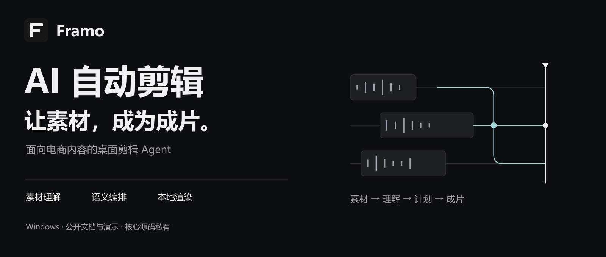
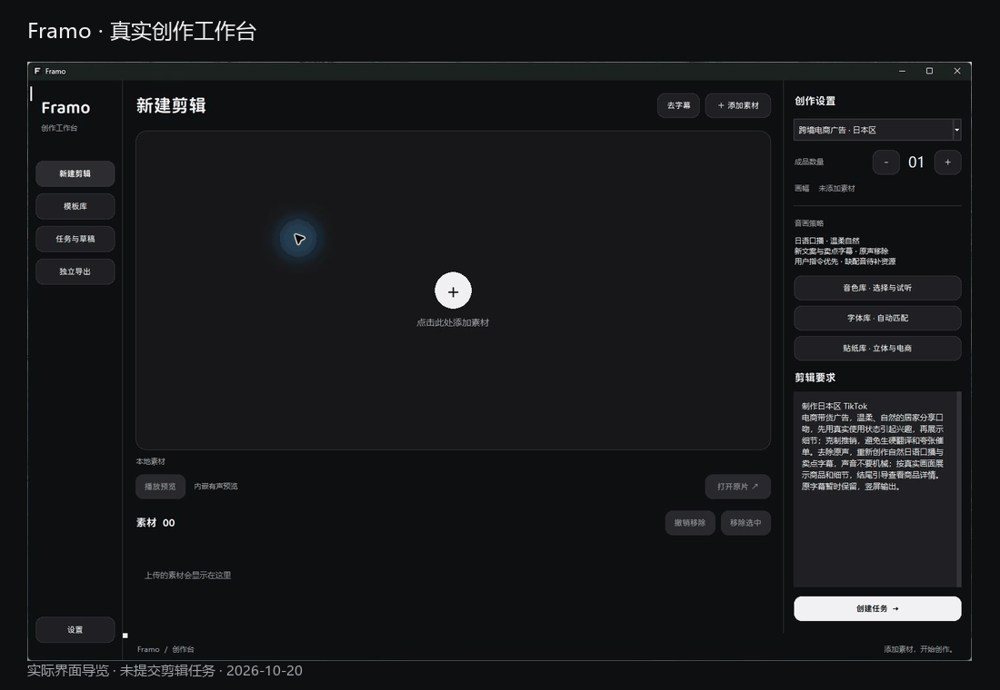

<picture>
  <source media="(max-width: 600px)" srcset="assets/github/hero-mobile.png">
  
</picture>

# Framo · 电商视频剪辑 Agent

从一组本地素材出发，理解剪辑要求、组织镜头与声音，再生成可检查的 MP4。Framo 将模型规划与本地媒体工具连接成可追踪、可恢复的生产流程。

**Windows 桌面 · 模型规划 · 本地渲染 · 核心源码私有**

本仓库公开产品文档、真实界面与脱敏评估，不包含应用核心源码。现有 **1.3.0 安装版**与本机后续修改存在差异，下载前请查看[安装版核验摘要](docs/INSTALLER_VERIFICATION_1_3_0.md)。

## 在一个工作台，完成剪辑流程

导入素材，在右侧选择创作方式、成品数量和剪辑要求；任务生成后查看阶段记录与实际成品。当前默认通过本地 FFmpeg 生成 MP4，不要求外部编辑器参与直接成片路径。

| 跨境电商 | 自定义剪辑 | 原声长视频 |
|---|---|---|
| 日本区、美国区的本地化口播与卖点文案 | 按用户要求组织结构、语言和元素 | 保留素材原声与已有字幕，按语义混剪 |
| 核对目标语言与所选音色 | 明确写出需要的配音、字幕与效果 | 不生成新的口播、字幕或BGM |

[查看各模式的实际工作流](docs/WORKFLOWS.md) · [复制剪辑要求示例](examples/BRIEFS.md)

## 模型提出计划，程序负责执行边界

<picture>
  <source media="(max-width: 600px)" srcset="assets/github/pipeline-mobile.png">
  
</picture>

- **先有证据**：本地转写与真实抽帧，形成带来源和时间的素材观察。
- **再做规划**：模型选择已有语义单元、组织章节和剪辑方案。
- **约束落到代码**：核对来源、区间、目标时长、资源与固定开头，拒绝不可执行的计划。
- **交付可追踪**：本地渲染，保存阶段事件、产物指纹和检查点，检查媒体信息与完整解码。

当前是有界的工作流编排型 Agent。鉴权、网络、缺少素材或无法通过的计划仍可能需要用户处理；技术检查不能代替完整人工视听。

[深入了解 Agent 设计](docs/AGENT_DESIGN.md) · [系统架构](docs/ARCHITECTURE.md) · [数据模型](docs/DATA_MODEL.md)

## 面向长短视频的创作设置

| 能力 | 当前范围 |
|---|---|
| 素材导入 | 最多20条，单条最长7分钟；还需满足媒体技术与模式校验 |
| 长视频 | 成品最长10分钟，按主题和完整表达组织内容 |
| 批量生产 | 单批最多15条独立输出；常规队列默认一条执行 |
| 预设音色 | 中文10种（女声5、男声5）、日语9种、英语50种 |
| 原声混剪 | 前40秒连续保留一条素材的开头，句中可延到句末；之后语义交叉编排 |
| 元素编排 | 转场、文字动效、贴纸、轻特效和音效；原声混剪贴纸／光点合计最多100次 |

**批次不同开头**属于本机后续修改：明确要求本批开头不同后，按编号优先分配不同内容来源，来源不足时无法保证全部不重复。此能力尚未进入现有1.3.0安装程序。

字体目录记录54个家族、贴纸目录151条、音效目录24条。目录数量不代表每次全部使用，也不代表逐项完成跨电脑验收。[查看完整能力与边界](docs/CAPABILITIES.md)

## 看真实界面

导览来自当前本机软件实拍，只展示操作入口，没有模拟剪辑进度或成功提示。[查看原始截图与演示范围](docs/DEMO.md)

## 实测记录与当前状态

| 证据 | 已确认结果 |
|---|---|
| 选定离线回归 | 同样87项用例在源码和实际运行模块分别通过；网关16项本地测试通过 |
| 最新七条批次 | 7份现存三分钟文件，七种连续开头来源；渲染报告记录解码通过 |
| 元素核验 | 六条同时存在转场、贴纸／光点、音效和特效；第4条漏加音效与轻特效，仍待修复 |
| 现有安装文件 | 1.3.0安装程序SHA256已重新核对，本轮没有重新构建或安装 |

**文件生成完成不等于全部创意要求合格。** 最新批次的元素缺失和版本差异已列入[已知问题](docs/LIMITATIONS.md)；本轮没有逐条全程人工审片，不把小样本写成总体成功率或平台去重率。

[阅读评估报告](docs/EVALUATION.md) · [真实案例与失败样本](docs/CASE_STUDIES.md) · [脱敏证据](evidence/README.md)

<strong>展开：版本、历史记录与核验范围</strong>

文档／证据快照为 **framo-docs-20261020**，日期2026-10-20，Asia/Shanghai。

- 源码标记1.3.0、本机运行目录标记1.2，16个模块项存在内容或存在性差异；安装构建与运行目录另有7项差异。这是不同对照，不可相加当作独立缺陷数。
- 历史十条批次保存了10/10技术交付报告，但当前路径中3份文件缺失、7份与旧指纹不符，原因未确定，因此只保留为历史记录，不作为本轮再验收通过。
- 本轮重新核验最新七条文件、媒体参数、报告指纹和连续开头时间线，没有重做全部视频解码或完整人工审片。
- 本轮未重新执行付费模型生成、独立新电脑安装或软件打包，未创建访问码或发布新的统一软件版本。

查看[版本快照](docs/VERSIONING.md)、[安装版验证](docs/INSTALLER_VERIFICATION_1_3_0.md)和[评估](docs/EVALUATION.md)。

## 文档与使用入口

| 了解产品 | 理解技术 | 使用与维护 |
|---|---|---|
| [产品需求 PRD](docs/PRD.md) | [Agent 设计](docs/AGENT_DESIGN.md) | [安装与首次使用](docs/INSTALLATION.md) |
| [能力矩阵](docs/CAPABILITIES.md) | [系统架构](docs/ARCHITECTURE.md) | [故障排查](docs/TROUBLESHOOTING.md) |
| [交互规范](docs/UX_SPEC.md) | [接口与数据契约](docs/API.md) | [发布说明](docs/RELEASING.md) |
| [路线图](docs/ROADMAP.md) | [数据模型](docs/DATA_MODEL.md) | [全部文档](docs/INDEX.md) |

安装程序在仓库 **Releases** 单独发布；没有安装附件的发行记录不构成软件下载。访问码另行发放，不随仓库或安装包提供。模型所需文本和抽样画面会经网关发送给提供方，具体见[隐私说明](docs/PRIVACY.md)。

问题反馈请按[反馈指南](CONTRIBUTING.md)提交脱敏信息，不要公开访问码或私人素材。第三方资源遵守各自条款，见[第三方声明](THIRD_PARTY_NOTICES.md)与[许可说明](LICENSE)。

---

**Framo** · Local-first video editing, with traceable planning and delivery.  
Product documentation and demonstrations are public. Application source remains private.
