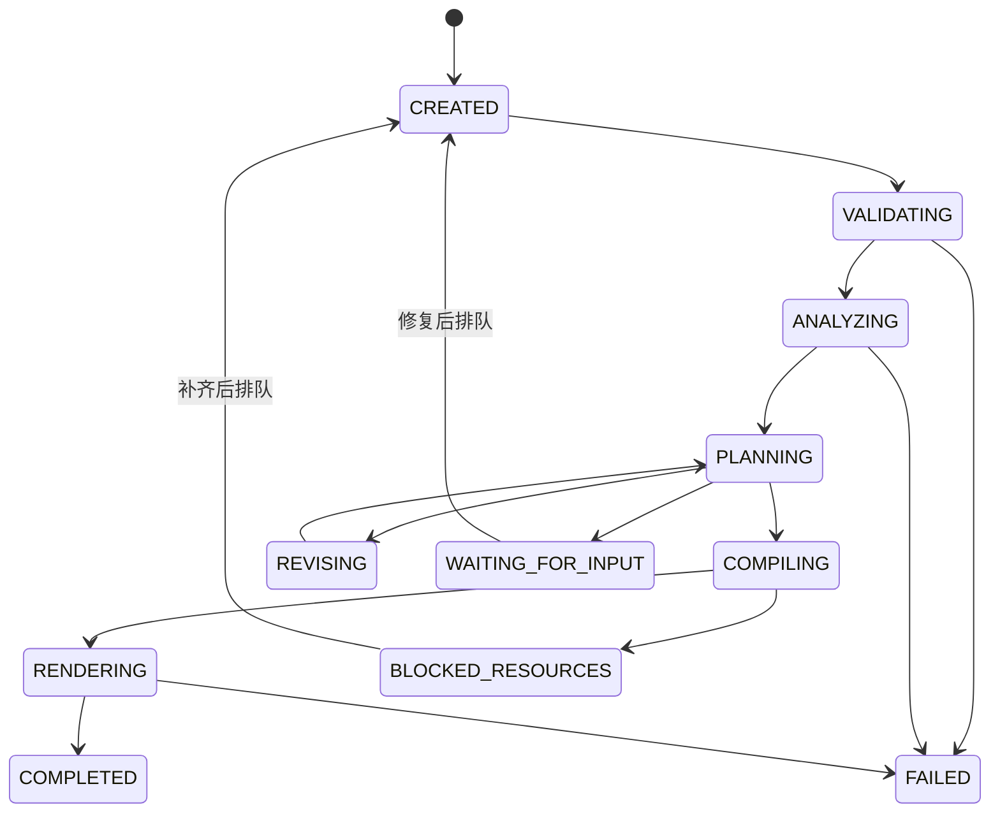

# Agent 设计与执行契约

## 1. 目标、观察、规划、行动和检查

| 环节 | 输入与输出 | 控制边界 |
|---|---|---|
| 目标 | 用户要求、模式、语言、时长、素材、成品数 | 用户要求必须落入支持范围；素材内容不作为系统指令 |
| 观察 | 本地转写、技术参数、真实抽样帧、视觉观察 | 区分未检测到、无证据和事实；静帧不证明连续事件 |
| 规划 | 已有语义单元ID、章节、镜头、口播与字幕计划 | 模型只提出候选方案，不能凭空指定任意素材 |
| 行动 | 编译、资源选择、本地合成和渲染 | 确定性程序调用允许的工具，不执行模型生成的任意命令 |
| 检查 | 时长、区间、资源、文案、媒体流、解码 | 技术检查和语义／人工检查的结论分开保存 |
| 修订 | 带原因的结构化反馈和已有检查点 | 有界重试与用量上限，不能无限循环或改写验收结果 |

Framo属于工作流编排型Agent。当前证据支持单一任务编排器调用模型和工具，不支持宣传多个独立Agent动态协商、长期自学习或通用电脑自主操作。

## 2. 模型与程序分工

模型承担需要语言和语义判断的环节：画面描述、素材理解、章节与候选选段、文案和剪辑结构。程序承担硬约束：素材存在性与SHA256、时间戳合法性、选段非重叠、目标时长、固定开头、资源路径、渲染参数和输出解码。

主体布局提示只在有真实框证据时使用；证据不足时回到保守布局，不伪造检测。模型视觉接口不可用时可能降级为已有文字和元数据，必须保留降级记录，不能仍声称已经完成同等视觉分析。

## 3. 原声长视频的规划

1. 从转写时间与标点建立完整表达单元，保护问题回答、因果和连续动作。
2. 固定开头从合格源零秒开始，至少40秒；句中切点可延至完整单元结束。
3. 后半段候选排除已经使用的开头；模型按主题给出现有单元ID与章节。
4. 编译器按实际帧数和完整单元拟合总长，不重复、变速或冻结画面凑时长。
5. 编排转场、贴纸、轻特效和低音量音效，保留原音乐、口播与画面已有字幕。

明确要求本批开头不同后，将批次编号纳入选择；先按完整源文件内容指纹排除完全重复文件，再结合开头文字与抽样画面差异排序。该排序只帮助多样性，不能当作平台去重分数。

## 4. 状态与失败

图示是主要直接成片路线，不是所有历史状态转换的穷举。取消在安全检查点处理；关闭界面可能仍保留已经启动的后台工作进程，未启动队列通常等待工作台再次运行。

## 5. 任务记忆与可追踪性

任务规格、转写／观察、计划、编译时间线、资源与渲染报告按任务和修订保存。SQLite事件有单调序号和时间，产物有哈希。这里的“记忆”是可校验检查点与缓存，不是模型权重训练或无界向量记忆系统。

## 6. 有界自主性

桌面运行配置的当前上限为每次执行最多48次模型请求、已报告累计用量达到640000 Token后停止新增请求。最后一次可能越过停止阈值，因此它不是精确硬费用上限；续跑会产生新用量。模型格式、候选不足和文案问题分别有有限修订逻辑，不能声称所有阶段统一无限重试。

鉴权失败、资源缺失、没有合格素材、版本绑定冲突和上游结果不确定都可能要求用户处理。网关恢复协议复用请求编号和已保存结果；上游状态无法确认时不盲目重复生成。

## 7. 当前设计缺口

最新案例表明，要求解析器可能接受“不要字幕”作为关闭音效和特效的引用，尽管该引用并未提及这两类元素。这说明引用真实存在不代表引用与类别相符。应增加类别作用域与否定词完整性校验，以及渲染后按用户要求核对真实轨道。此项为 KI-01，当前尚未修复。

## 8. 对外陈述

可以说“支持任务级自动分析、规划、执行、技术检查与有界恢复”。不能说“任何素材保证一次成功”“逐帧理解了所有画面”“检查通过就等于全部创意要求通过”或“平台保证去重通过”。
