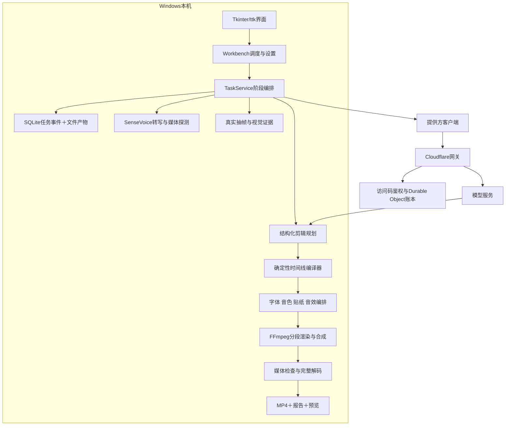

# 系统架构

## 组件边界

桌面界面直接调用Python后端，不要求本地HTTP页面承载当前桌面交互。代码仍保留旧环回网页工作台和原生草稿兼容路径，不应把这些历史模块写成当前界面的默认依赖。

## 主要职责

| 层 | 私有模块 | 职责 |
|---|---|---|
| 展示 | desktop_studio、desktop_workbench、desktop_* | 素材、创作设置、资源库、任务状态和预览 |
| 应用服务 | workbench、task_service、background | 创建任务、排队、启动工作进程、阶段转换、恢复和取消 |
| 证据 | analysis_cache、direct_vision、framo_supplements | 已核验的转写、抽帧、观察、证据ID和布局提示 |
| 规划 | deepseek、commerce、long_video、original_montage | 语义选择、章节、文案、结构化计划 |
| 约束 | editing_rules、video_limits、locked_opening、timeline_compiler | 用户要求、媒体上限、开头、时间范围、来源和可执行性 |
| 资源与执行 | local_voice、direct_resources、direct_renderer、independent_export | 本地音色、声音设计、资源指纹、视频渲染 |
| 状态 | task_store、file_io | SQLite记录、原子JSON、修订、指纹和事件 |
| 接入 | provider、gateway_credentials；网关index/policy/recovery | 模型连接、凭据、额度、可恢复请求与不确定状态 |

## 执行与恢复

创建任务时保存任务规格及运行时绑定；输入素材、模型／工具和关键代码变化会影响恢复。复用检查点要求产物指纹和输入一致。运行时升级不是把旧任务的失败状态改成成功，而是明确的迁移或新任务过程。

模型输出不会直接作为任意Shell执行。编译层只接受已知来源、合法范围和支持的渲染元素。本地工具由程序调用，并处理取消、超时与子进程回收。

## 并发和性能

常规工作台队列默认一条剪辑执行。历史特定机器的批次监督器曾最多重叠两条渲染；这是操作端策略，未改成产品默认。编码器线程按CPU计算、上限4，滤镜和解码队列仍有界。

约每十秒从FFmpeg实际进度读取秒数和速度。分段编码、合成、最终编码和解码检查分别报告。不能通过某个临时文件增长判断任务已经成功。

## 数据出设备的范围

源视频、转写缓存和渲染在本机处理；模型所需文字和抽样画面会发送到网关和提供方。网关的短期结果恢复会保存生成结果，因此产品应描述为“本地优先”，而不是“全离线”。详见[隐私说明](PRIVACY.md)。

## 部署现状

源码与运行目录存在16个模块差异，运行目录额外包含证据补充模块；本文保留这些实际边界。完整文件指纹见[版本快照](VERSIONING.md)，没有把两个目录整体互相覆盖或修改业务代码。
