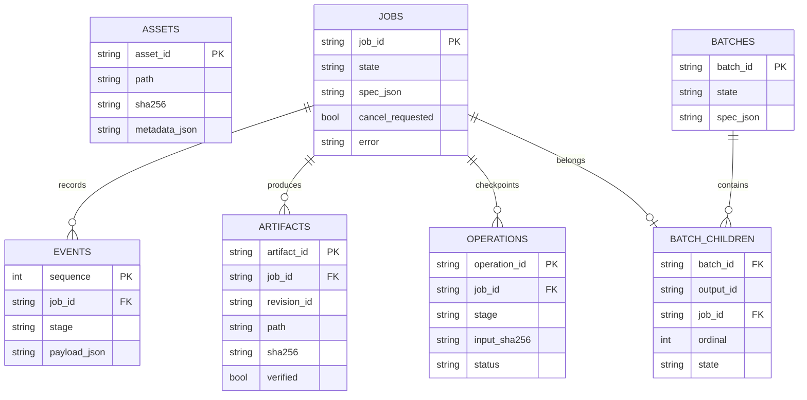

# 数据模型与持久化

当前本机实现使用SQLite存储任务索引、事件、产物引用和操作记录，文件系统保存真实媒体、转写、计划和各修订报告。公开仓库不含实际数据库。

ASSETS与任务的关联保存在任务规格的asset_ids中，不伪装成现有数据库具有独立关联表。图省略了创建／更新时间和部分字段。

## 核心契约

- Asset：文件路径、技术参数和SHA256；原文件变更后不能信任旧分析。
- TaskSpec：用户要求、工作流、目标、素材ID、策略版本、明确覆盖、资源开关和运行时绑定。
- Timeline：源区间到目标区间的映射、完整时长、字幕／旁白安排与固定开头信息。
- Artifact：任务、类型、修订、路径、SHA256和verified标记。verified只表示该产物所定义的验证范围，不代表整体创意被人工认可。
- Operation：输入哈希和阶段结果，辅助断点复用与重复执行控制。
- Batch：子任务和输出编号分别保存，汇总状态不替代每条输出的真实状态。

## 文件和事务

JSON使用临时文件替换方式原子写入；SQLite有独立事务。它们不是跨文件和数据库的单一分布式事务，因此恢复时仍需重新检查指纹、已保存报告及阶段操作状态。

产物按revision保存，重试不应覆写原修订。公开案例只保留脱敏计数、技术参数和必要指纹，不复制用户路径、转写全文、任务ID或素材。

## 网关账本

访问码登记保存哈希、启用状态、到期时间、允许模型、每日加权额度、累计请求上限和并发限制。Durable Object原子处理额度和请求身份；可恢复结果按用户与请求摘要隔离，短期保存。它与桌面SQLite是两套状态系统，不能直接将网关额度当作本机成品数。
