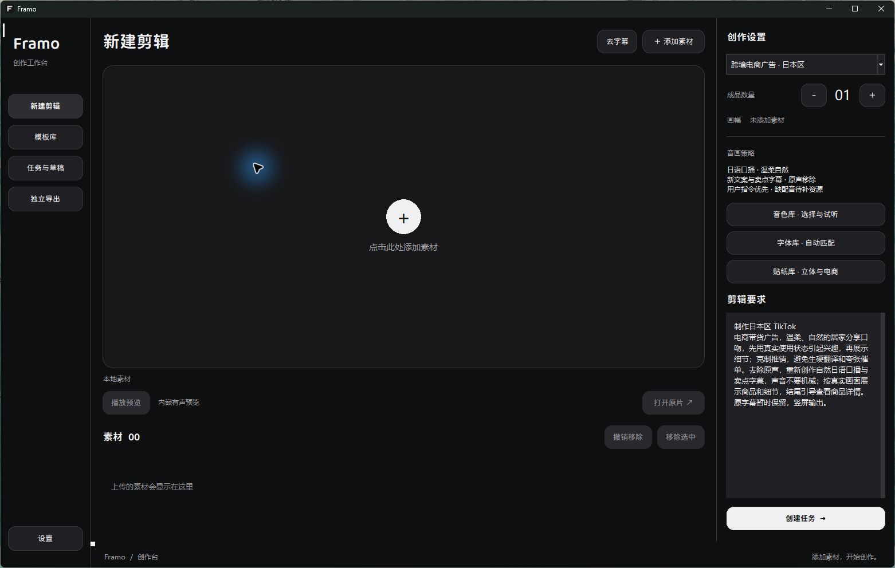
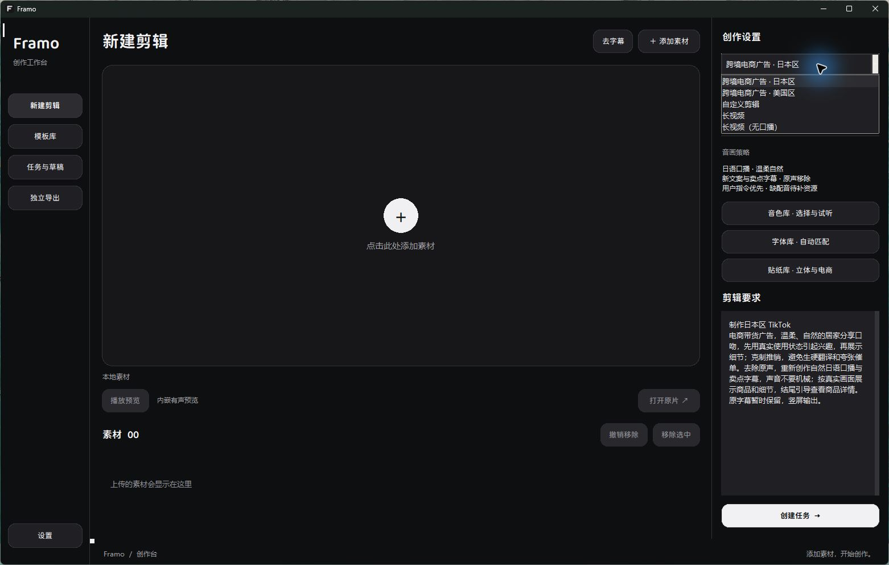
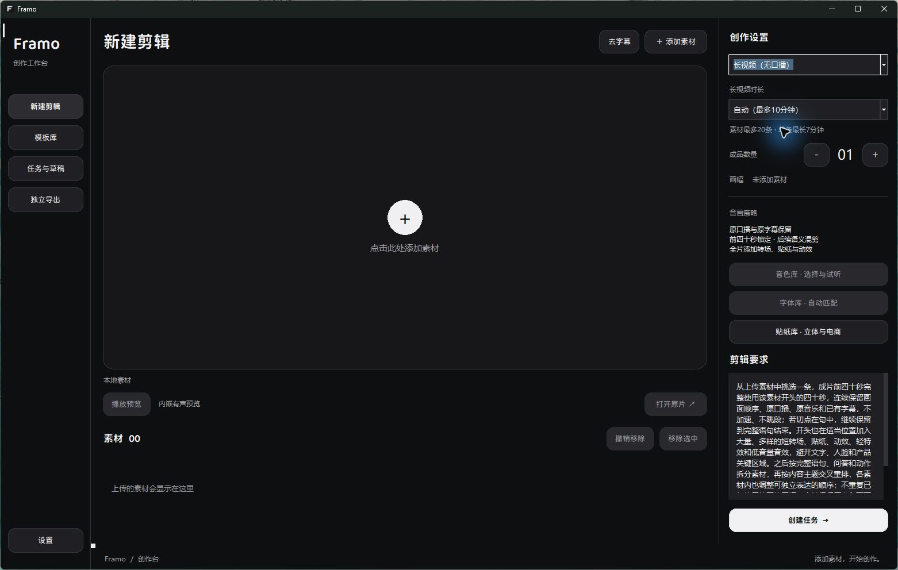
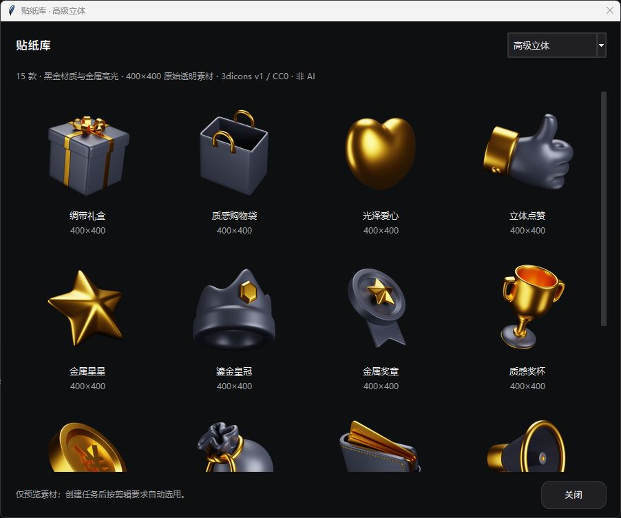
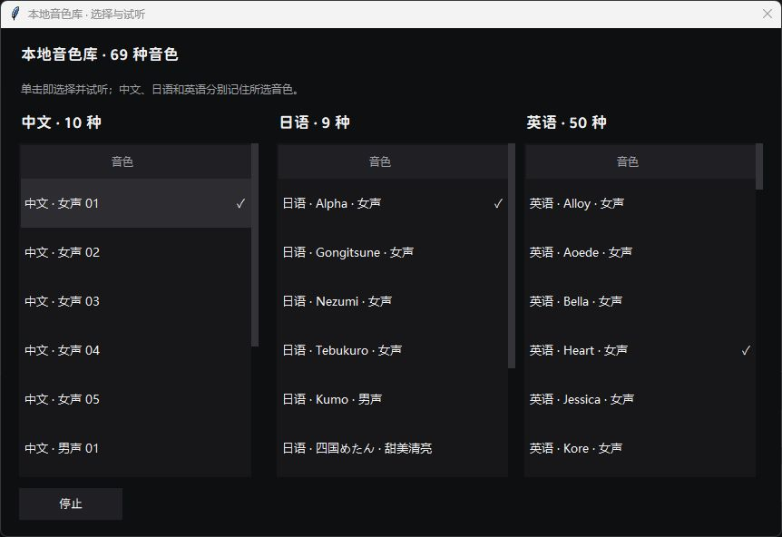

# 真实界面与演示

本轮通过computer-use读取并打开实际本机Framo，采集以下五组真实界面，没有提交剪辑任务、调用付费模型或公开私人素材。它不是另一台干净电脑的安装演示。

## 创作工作台

## 当前类型

## 原声长视频

## 贴纸库

## 音色库

## 导览附件

[界面导览GIF](../assets/interface-tour.gif)依次展示真实界面，每张使用静态停留，没有伪造鼠标操作、排队进度或成功提示。GIF是界面导览，不是完整任务录屏；实际成片情况请看[案例](CASE_STUDIES.md)。

公开目录不附带私人视频。当前可直接展示的内容是界面与脱敏案例；新增公开成片演示应使用已确认有公开权限的素材，再记录模型调用、执行和输出，不能把私有样片自动公开。

完整演示建议顺序：介绍目标 → 导入授权素材 → 配置模式／时长／数量 → 显示实际执行事件 → 播放真实成片 → 展示要求核对与已知限制。当前这段完整录屏尚未制作，不以本GIF替代。
